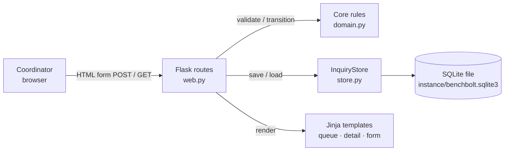

# Bench & Bolt · Repair Inquiry Queue — Project Record

IS218-003 · Group Customer Studio · **one shared record for the team**.
Simulated customer: all people, shops and records are fictional. Customer agreements live in
[`customer-kit/CUSTOMER-NOTES.md`](customer-kit/CUSTOMER-NOTES.md); this file links there instead of repeating them.

Status labels used below: **Proposed** (someone suggested it) · **Agreed** (team + simulated customer agreed) ·
**Implemented** · **Checked** (an actual check ran, with a link). Unrun checks say **not run**.

## Project and current status

| Item | Value |
| --- | --- |
| Customer / scenario | Maya Chen, Bench & Bolt bike repair — [`scenarios/repair-shop.md`](customer-kit/scenarios/repair-shop.md) · *Agreed by team — see [CUSTOMER-NOTES](customer-kit/CUSTOMER-NOTES.md)* |
| Audience and main task | Shop coordinator turns scraps of paper into one queue with an honest status |
| Promise (this term) | Coordinator records a walk-in inquiry, reviews it in a queue, moves it through allowed statuses; data survives restart |
| Dream | Rider self-service intake with a clear receipt (Option B) once the staff flow is solid |
| Experiment | Explicit transition table vs. if/else status checks (see §3). If the table adds no value, keep the simpler code |
| Stack | Python 3.12 · Flask · SQLite · pytest — *Proposed* (reasons in §2) |
| Repository / setup | this repo · see [README](README.md) |
| Current stage | **Review 1 · Plan.** Core rule module + unit tests exist; no web app or store yet |
| Contributions | see §1 Team table |

---

## 1 · Agile work plan

**Problem.** Repair requests arrive on paper and in messages; nothing gives the shop one queue or an honest status.

**In scope.** Option A · Staff intake: one trusted coordinator, local app, create → queue → decide → complete, persistent store.

**Out of scope.** Rider-facing form (Option B), logins/hosting, booking or appointments, payments, quotes, inventory,
emails/SMS, real contact data. A preferred day is text only — never shown as confirmed.
The scenario's “Needs follow-up” flag is held until the customer introduces it after slice 1.

**Scope comparison** (decide with the customer — record the reason in CUSTOMER-NOTES):

| | A · Staff intake | B · Rider intake |
| --- | --- | --- |
| Roles | 1 (coordinator) | 2 (rider + coordinator) |
| UI | Form + queue in one place | Public form + receipt + private queue |
| Security | Local, trusted operator; no auth needed | Must build and test a server-side permission boundary |
| Effort / risk | Lower; fits the time left | Higher; auth is new work for the team |
| **Proposed choice** | ✅ fits the term and still proves the full workflow | Deferred (the “Dream”) |

### Backlog

**Agreed** by the team (see [CUSTOMER-NOTES](customer-kit/CUSTOMER-NOTES.md)). One user: the coordinator.

| # | Story | Acceptance criteria (observable) | Priority |
| --- | --- | --- | --- |
| S1 | **Intake** — As the coordinator, I create a repair inquiry so I can track upcoming work. | Valid input → stored record with new ID + *Pending review*. Blank problem, bike type outside city/road/other, problem > 240 chars or preferred day > 40 chars → error shown, **no record created**. Preferred day never displayed as confirmed. | Must |
| S2 | **Queue** — As the coordinator, I see saved inquiries so the shop can work on them. | Queue lists records in creation order with exact values and status. Restarting the app with the same DB shows the same records. | Must |
| S3 | **Decision** — As the coordinator, I accept, decline and close (complete) a request so its status stays honest. | Pending → Accepted/Declined; Accepted → Completed. A direct request to complete a *Pending review* inquiry, or to change a Completed/Declined one, is rejected (409) and the stored record is unchanged. | Must |
| S4 | **Completed** — As the coordinator, I see how many inquiries we've completed so I can measure output. | Queue shows a Completed count and a Completed-only filter. Count matches the stored records, updates after a status change and survives restart. No customer details stored. | Should |

**Data / status rules** (from the scenario):
`Pending review → Accepted | Declined`, `Accepted → Completed`; Completed and Declined are terminal.
Accepted = shop agreed to take the job — not a reserved time or a charge.

### Milestones

| Milestone | Target | Done when |
| --- | --- | --- |
| M0 · Plan (Review 1) | Nov 12 | Customer, option, stories, rules, owners agreed; this record + CI exist |
| M1 · First slice (Review 2) | see [schedule](https://kaw393939.github.io/is218-studio/course/schedule.html) | S1 + S2: one stored inquiry reaches the queue; positive + negative checks pass |
| M2 · Integrated (Review 3) | schedule | S3 + S4 working end-to-end; customer change implemented or deferred; scope frozen |
| M3 · Hand off (Review 4) | schedule | Real peer issue → change → retest; reproducible setup; acceptance demo |

### Team, ownership and cross-review

Each member owns comparable **design + development + QA** work and reviews someone else's slice.
Commit counts don't measure contribution — record what each person actually did.

| Member | Slice 1 (Review 2) | Slice 2 (Review 3) | Cross-reviews |
| --- | --- | --- | --- |
| **1 · Anya** | **Intake form:** decide what the coordinator enters and how errors show · build form + submission route using `validate_inquiry` · test a valid submission and a blank problem (S1) | **Completed count + filter** in the queue; status wording with no booking/payment claims (S4) | **Shree's queue:** submit an inquiry, check its details and *Pending review* status display correctly |
| **2 · Dhruvi** | **SQLite storage:** define what's saved · save/retrieve, assign ID, set initial status · test retrieval after restart (S2) | **Status rules in storage:** allowed changes saved, rejected change leaves record unchanged (S3) | **Anya's form:** invalid submission shows an error and creates no database row |
| **3 · Shree** | **Coordinator queue:** decide what the coordinator sees · build queue page from Dhruvi's records · connect intake → queue · test submit-to-queue path (S2) | **Decision buttons:** Accept/Decline/Complete + end-to-end test (S3) | **Dhruvi's storage:** saved details and order preserved after restart |
| **All** | Discover the need, compare options, agree stories; agree `Inquiry` fields + store functions (§2, §3) before coding | | Rotate owner/reviewer; record real findings in GitHub issues |

**Dependencies.** `domain.py` (rules) → `store.py` (needs status enum) → routes → templates. All three agree the
`Inquiry` fields and store function names first (the form ↔ storage ↔ queue contract), then work in parallel.

**Review process.** Every change goes through a PR; the cross-reviewer from the table approves; CI must be green.
Findings from a real person go in a GitHub issue using the *Peer review finding* template.

---

## 2 · Technical architecture



**Data model** — table `inquiries`:

| column | type | rule |
| --- | --- | --- |
| id | INTEGER PK AUTOINCREMENT | generated; also gives creation order |
| rider_label | TEXT NOT NULL | synthetic label only (e.g. `Rider-001`) |
| bike_type | TEXT NOT NULL | CHECK in (`city`,`road`,`other`) |
| problem | TEXT NOT NULL | 1–240 non-blank chars |
| preferred_day | TEXT | ≤ 40 chars, free text, not a booking |
| status | TEXT NOT NULL | one of the four statuses; default *Pending review* |
| created_at | TEXT NOT NULL | ISO timestamp |

**Data flow (S3 example).** Click “Complete” → `POST /inquiries/7/status` → route loads #7 from store →
`check_transition(current, Completed)` → allowed: store updates in one transaction / rejected: 409, nothing written → re-render queue.

**Why this stack, and alternatives**

| Choice | Why it fits | Alternative considered | Tradeoff |
| --- | --- | --- | --- |
| Python + Flask | Team knows Python from RPS-001; small; server-rendered HTML means no separate frontend | Node + Express | Equal fit; Python reuses course tooling |
| SQLite (stdlib `sqlite3`) | Real persistent file, zero install, survives restart; one local user | JSON file · Postgres | JSON has no constraints/transactions; Postgres needs a server we don't need for Option A |
| Server-rendered Jinja | Fewer moving parts than a SPA; easy to test with Flask test client | React SPA | SPA adds a build step and an API contract we don't need |
| Hosting | **Local only** (Option A, trusted operator) | Render/Fly | Hosting would require auth on coordinator actions → out of scope |
| External services | **None** (no email, payments, maps) | — | Keeps data synthetic and scope small |

**Cost** $0. **Security assumptions:** runs on localhost for one trusted coordinator; no auth because it is not publicly reachable
(if that ever changes, coordinator actions must be protected on the server — scenario rule). Parameterized SQL only;
Jinja autoescaping on; Flask debug off outside dev; synthetic data only.
**Deployment assumption:** `flask run` on the coordinator's machine; optional Docker later per course lesson, with the DB on a volume.

---

## 3 · Code architecture

| Module | Responsibility | Depends on |
| --- | --- | --- |
| `domain.py` | Status enum, transition table, `validate_inquiry`, `check_transition`. Pure, no I/O | nothing |
| `store.py` | `InquiryStore`: create, get, list, update_status (SQLite, transactions) | `domain` |
| `web.py` | Flask app factory + routes; turns HTTP into domain calls and back | `domain`, store **interface** |
| `templates/` | Form, queue, detail HTML | — |

**SOLID, applied only where it helps**
- **S**ingle responsibility: rules, storage and HTTP are separate modules, so changing wording never changes who can complete a job.
- **O**pen/closed: adding the “Needs follow-up” flag later adds a column and a field, not a change to the transition table.
- **L / I**: one small store interface (`create/get/list/update_status`); tests can use a temp-file SQLite store.
- **D**ependency inversion: `create_app(store)` receives the store, so tests inject a temporary DB instead of touching the real file.

**Pattern experiment (one).** *Problem:* status rules are easy to scatter across routes. *Option 1:* if/else checks inside each route.
*Option 2:* an explicit **transition table** (`ALLOWED_TRANSITIONS`) checked by one function — a state boundary, not the OO State pattern.
*Planned comparison:* same rejected/allowed tests run against both; keep whichever is shorter to read and harder to get wrong.
Current code tries Option 2. We are **not** using Repository/Factory/Strategy classes beyond a simple store class — unnecessary at this size.

**AI note.** The starter `domain.py` and tests were drafted with an AI assistant and reviewed by anya against the scenario.
Prediction to check at M1: AI will over-layer the store; we will reject layers we can't explain.

---

## 4 · Testing strategy

| Layer | What | Tool | Where it runs | Count (target) |
| --- | --- | --- | --- | --- |
| Unit | Validation (normal, invalid, boundary 1/240/241, 0/40/41), every allowed + rejected transition | pytest | local on save + CI | ~20, < 1 s |
| Integration | Store round-trip; **restart** = new store on same file sees same record; route returns 409 and DB unchanged on bad transition; invalid POST creates no row | pytest + Flask test client + temp SQLite | local + CI | ~8 |
| End-to-end | One happy path city bike → Completed (count goes up); one rejected action shown to user | Playwright (`pytest -m e2e`) | local before merging to main; CI later | 2 |

**Story → test map:** S1 → unit validation + integration “invalid POST creates no row” · S2 → integration restart · S3 → unit transitions + integration 409 ·
S4 → integration: Completed count matches stored records after a status change and after restart.
**Test data:** synthetic fixtures only (`Rider-001`, `city`, “Flat rear tire”). Each test gets its own temp DB (pytest `tmp_path`).
**Why this mix:** rules are cheap to test exhaustively at the unit level, so e2e only covers the two paths the customer will watch; no duplication.

```sh
pytest            # unit + integration (fast, default)
pytest -m e2e     # browser tests (slow, opt-in)
```

---

## 5 · Code-quality checks

| Check | Tool / rules | Command | When |
| --- | --- | --- | --- |
| Format | ruff format (line 100) | `ruff format --check .` | on save; CI |
| Lint | ruff: E, F, I (imports), B (bugbear), UP, SIM, S (bandit rules) | `ruff check .` | before commit; CI |
| Types | mypy `--strict` on `src/` | `mypy` | before commit; CI |
| Security | bandit on `src/`; pip-audit on dependencies | `bandit -q -r src` · `pip-audit` | CI |
| Tests | pytest (+ coverage report) | `pytest` | before push; CI |

CI: [`.github/workflows/ci.yml`](.github/workflows/ci.yml) runs all of the above on every PR and on `main`.
**Merge rule:** a PR merges only when CI is green and the assigned cross-reviewer approves. A failure is fixed on the same branch
(`ruff format .` / `ruff check --fix .` for style); never disable a rule without a comment explaining why.

---

## 6 · Build and review sequence

1. **First slice (M1):** `store.py` + `POST /inquiries` + queue page → one stored inquiry reaches the queue; restart check. (Anya: intake, Dhruvi: storage, Shree: queue — integrate in the same week.)
2. Decision routes + 409 handling (S3), then the Completed count/filter (S4).
3. Ask the simulated customer for the one bounded change; implement or defer with a reason.
4. Real classmate tries a task without coaching → issue → change → retest.

**Open questions** (also Pending in CUSTOMER-NOTES): Does the coordinator need to edit an inquiry's text after creation? Sort queue by status or by creation order only?

**How feedback updates the plan:** each review finding becomes an issue; if it changes scope, update the backlog table above and CUSTOMER-NOTES in the same PR.

## Evidence log (actual checks — keep updating)

| Date | Revision | Command | Expected | Actual |
| --- | --- | --- | --- | --- |
| 2026-11-17 | initial commit | `pytest` | 18 rule tests pass | **passed** (18) |
| 2026-11-17 | initial commit | `ruff check . && ruff format --check . && mypy && bandit -q -r src` | clean | **passed** |
| — | — | GitHub Actions CI | green on first push | **not run** (repo not pushed yet) |
| — | — | integration / e2e | — | **not run** (no store or web layer yet) |
| — | — | real peer review | — | **not run** |
